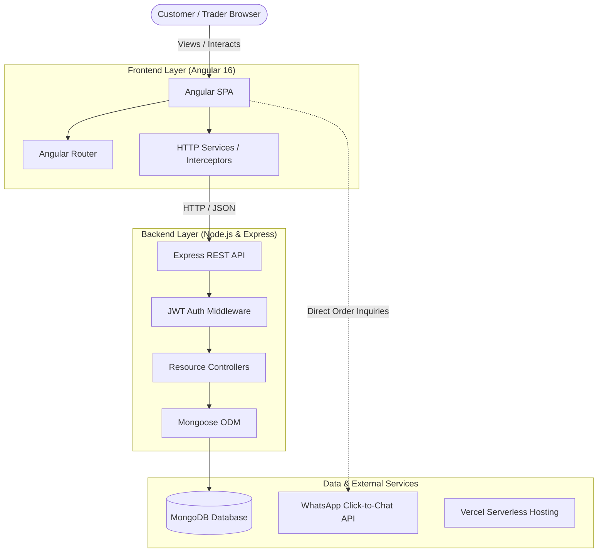

# Kasi-eCo 🛒🇿🇦

> **Empowering Township Commerce through Digital Storefronts & Direct Customer Connections.**

[](https://angular.io/)
[](https://nodejs.org/)
[](https://expressjs.com/)
[](https://www.mongodb.com/)
[](https://getbootstrap.com/)
[](https://kasi-e-co.vercel.app/)

---

## 📖 Overview

**Kasi-eCo** is a community-first e-commerce marketplace specifically designed for township (*kasi*) entrepreneurs, local artisans, and small business owners in South Africa. 

While conventional e-commerce platforms impose high barrier-to-entry friction, payment gateway delays, and complex logistics, **Kasi-eCo** connects buyers directly with informal and micro-merchants. Customers can browse curated local goods and services, view merchant credentials, and initiate real-time orders directly through **WhatsApp**—the primary digital communication and trade channel across South African communities.

---

## ✨ Core Features

### 🛍️ For Customers
* **Marketplace Discovery:** Explore diverse township goods including handmade crafts, fashion, patio furniture, culinary specialties, and local professional services.
* **Smart Filtering & Search:** Instant debounced search with category pills (`Handmade & Crafts`, `Fashion`, `Food & Beverage`, `Services`) to quickly find products.
* **One-Click WhatsApp Ordering:** Seamlessly connect directly with traders on WhatsApp with pre-filled product inquiry messages including item name, price, and customer greeting.
* **Merchant Trust & Transparency:** View dedicated trader storefront profiles featuring merchant bio, contact details, verified status, and full inventory.

### 💼 For Traders & Merchants
* **Onboarding & Auth:** Secure JWT-based registration and sign-in for merchants with role-based access control.
* **Real-Time Inventory Dashboard:** Add, update, and manage listings with real-time **Live Customer Card Previews** before publishing.
* **Flexible Media Handling:** Support for both external image URLs and local photo uploads with automatic Base64 parsing.
* **Dedicated Storefront:** Individual merchant profile pages showcasing contact information and catalog listings.

---

## 🏗️ Architecture



---

## 📁 Repository Structure

```text
Kasi-eCo/
├── Backend/                    # Node.js + Express REST API
│   ├── config/                 # Database configuration (db.config.js)
│   ├── controller/             # Business logic controllers (auth, trader, product, order)
│   ├── middlewares/            # JWT verification & signup validation
│   ├── models/                 # Mongoose schemas (User, Trader, Product, Order, Customer)
│   ├── routes/                 # Express routing endpoints
│   ├── index.js                # Server entry point
│   ├── vercel.json             # Vercel serverless deployment config
│   └── package.json            # Backend dependencies & scripts
│
├── Frontend/Kasi-eCo/          # Angular 16 Single Page Application
│   ├── src/
│   │   ├── app/
│   │   │   ├── _helpers/       # HTTP interceptors (JWT auth token handler)
│   │   │   ├── _services/      # Authentication & token storage services
│   │   │   ├── home/           # Landing page component
│   │   │   ├── products/       # Product marketplace & filtering component
│   │   │   ├── product-detail/ # Product specification & WhatsApp CTA component
│   │   │   ├── product-inventory/ # Merchant dashboard & product creation
│   │   │   ├── traders/        # Trader directory component
│   │   │   ├── trader-detail/  # Individual merchant storefront component
│   │   │   ├── login/          # Merchant / customer login
│   │   │   ├── register/       # User onboarding
│   │   │   ├── profile/        # Account profile view
│   │   │   └── services/       # Feature data services (Product, Trader, Inventory)
│   │   ├── assets/             # Branding logos, images, and graphics
│   │   ├── styles.css          # Global styling, CSS theme variables, utility classes
│   │   └── index.html          # HTML entry point with Bootstrap 5 & Icons
│   ├── angular.json            # Angular CLI configuration
│   └── package.json            # Frontend dependencies & build scripts
│
├── docs/                       # Project Documentation & Wiki
│   ├── WIKI.md                 # Documentation Index & Architecture Guide
│   ├── API_DOCUMENTATION.md    # Comprehensive REST API Reference
│   ├── TRADER_GUIDE.md         # Merchant onboarding & sales handbook
│   └── DEPLOYMENT_GUIDE.md     # Production deployment instructions
│
├── images/                     # Project screenshots and promotional assets
├── .gitignore                  # Git ignore rules for root, editor, and build outputs
└── README.md                   # Project overview and quick start guide
```

---

## 🚀 Getting Started

### Prerequisites
* **Node.js**: `v18.x` or higher
* **npm**: `v9.x` or higher
* **MongoDB**: A running MongoDB instance locally or a free [MongoDB Atlas](https://www.mongodb.com/atlas) cluster URI.
* **Angular CLI** (optional, recommended): `npm install -g @angular/cli@16`

---

### 1. Clone the Repository

```bash
git clone https://github.com/BulelaG/Kasi-eCo.git
cd Kasi-eCo
```

---

### 2. Backend Setup

1. Navigate to the backend directory and install dependencies:
   ```bash
   cd Backend
   npm install
   ```

2. Create a `.env` file in `Backend/` with your database credentials:
   ```env
   PORT=5555
   MONGODB_URI=mongodb+srv://<username>:<password>@cluster.mongodb.net/kasi_eco?retryWrites=true&w=majority
   JWT_SECRET=your_super_secret_jwt_key
   ```

3. Start the backend development server:
   ```bash
   npm start
   ```
   The backend will be running at `http://localhost:5555`.

---

### 3. Frontend Setup

1. Open a new terminal, navigate to the Angular project directory, and install dependencies:
   ```bash
   cd Frontend/Kasi-eCo
   npm install
   ```

2. Start the Angular development server:
   ```bash
   npm start
   # Or using Angular CLI:
   ng serve
   ```

3. Open your browser and navigate to:
   ```
   http://localhost:4200
   ```

---

## 📡 API Overview

The backend exposes RESTful endpoints under `/v1/`:

| Method | Endpoint | Description | Auth Required |
| :--- | :--- | :--- | :---: |
| `POST` | `/api/auth/signup` | Register new user/trader | No |
| `POST` | `/api/auth/signin` | Authenticate user & receive JWT | No |
| `GET` | `/v1/products` | Retrieve all active products | No |
| `GET` | `/v1/products/:id` | Retrieve single product details | No |
| `POST` | `/v1/products/addProduct` | Create a new product listing | Yes |
| `DELETE` | `/v1/products/:id` | Remove a product listing | Yes |
| `GET` | `/v1/traders` | List all verified traders | No |
| `GET` | `/v1/traders/:id` | Retrieve single trader profile | No |
| `POST` | `/v1/orders` | Place a customer order | Yes |

*For complete request schemas, response codes, and examples, refer to [API Documentation](docs/API_DOCUMENTATION.md).*

---

## 📚 Documentation & Wiki

Detailed specifications and guides can be found in the [`docs/`](docs/) directory:

* 📑 [**Project Wiki Index & System Architecture**](docs/WIKI.md)
* 🔌 [**REST API Documentation & Schemas**](docs/API_DOCUMENTATION.md)
* 🏪 [**Trader Onboarding & Merchant Guide**](docs/TRADER_GUIDE.md)
* ☁️ [**Deployment & Hosting Guide (Vercel & MongoDB Atlas)**](docs/DEPLOYMENT_GUIDE.md)

---

## 🤝 Contributing

Contributions to empower township traders are welcome!
1. Fork the Project
2. Create your Feature Branch (`git checkout -b feature/AmazingFeature`)
3. Commit your Changes (`git commit -m 'Add some AmazingFeature'`)
4. Push to the Branch (`git push origin feature/AmazingFeature`)
5. Open a Pull Request

---

## 📄 License

This project is open-source and available under the [ISC License](https://opensource.org/licenses/ISC).

---

<p align="center">
  Built with ❤️ for township communities and micro-merchants across South Africa 🇿🇦
</p>
